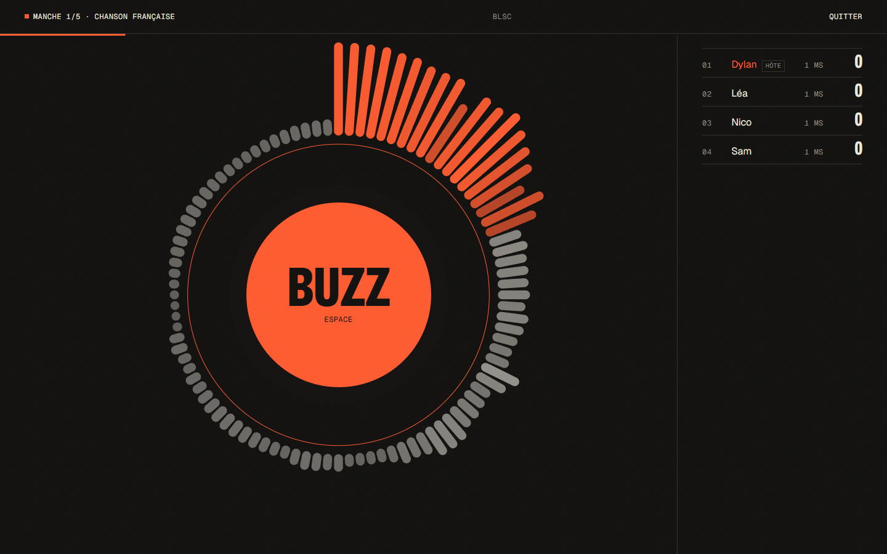
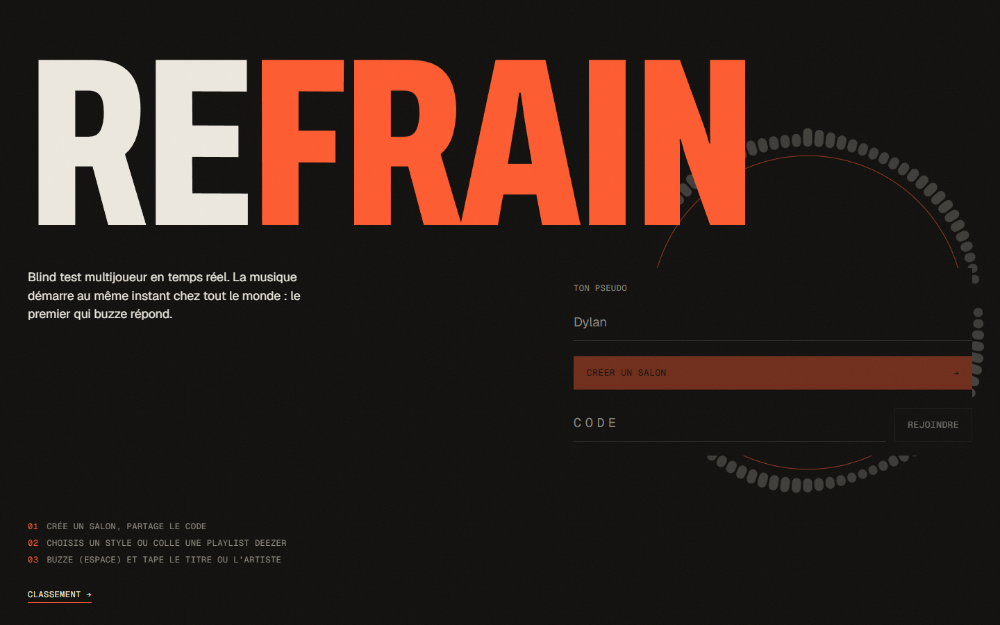
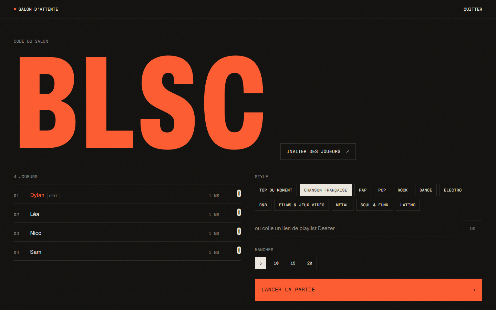
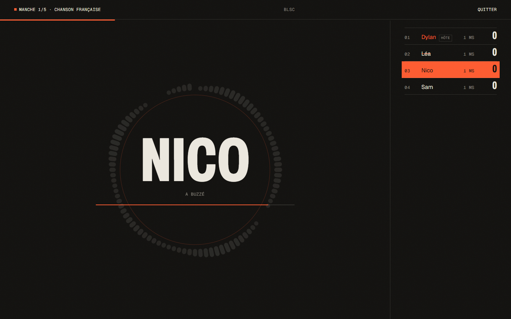
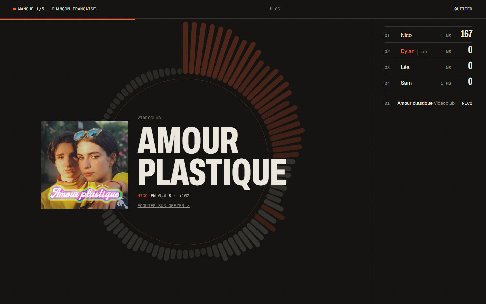
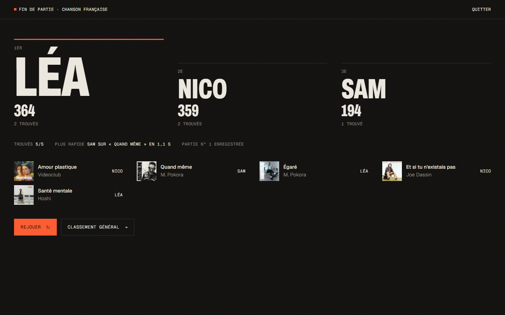
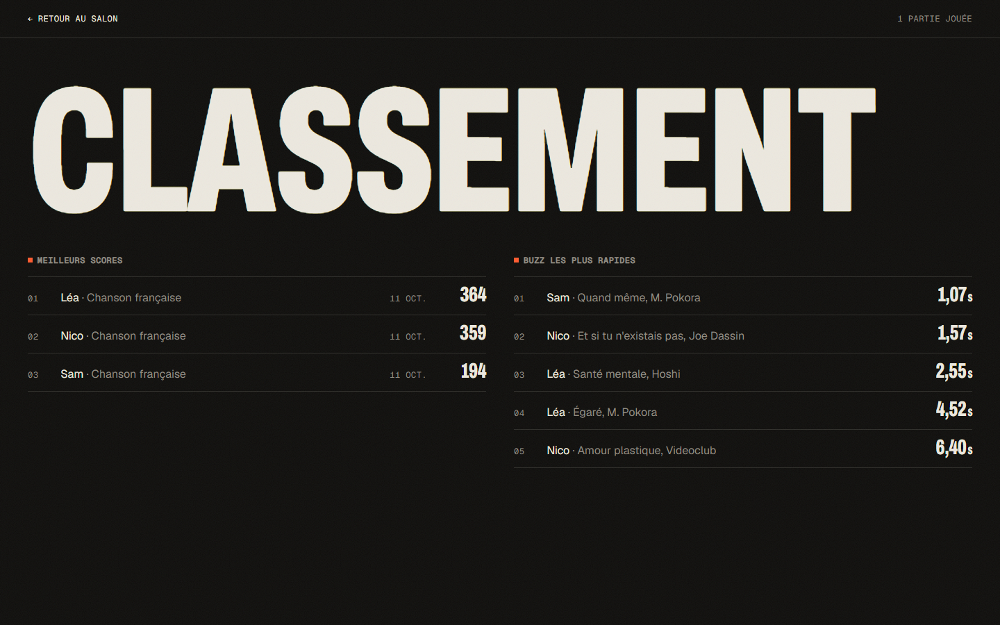
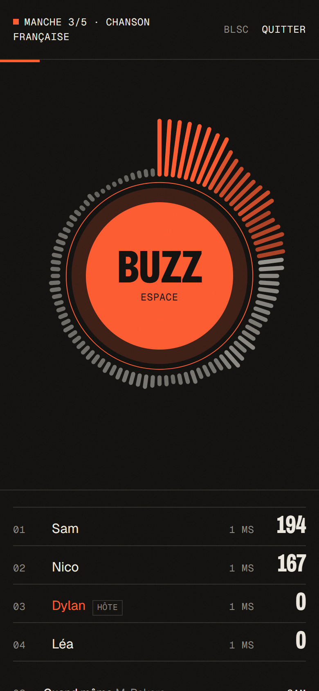

# Refrain

Blind test multijoueur en temps réel. On crée un salon, on partage le code, et la musique démarre **au même instant** sur tous les écrans. Le premier qui buzze tape le titre ou l’artiste.

`TypeScript` `Svelte 5` `Vite` `Node.js` `Fastify` `Socket.IO` `Redis` `PostgreSQL` `Drizzle ORM` `Web Audio` `Docker` `GitHub Actions`



| | |
|---|---|
|  |  |
| **Accueil** : un pseudo, un salon | **Salon d’attente** : code à partager, style ou playlist Deezer |
|  |  |
| **Buzz** : la musique se coupe partout, Léa (barrée) s’est déjà trompée | **Révélation** : trouvé par Nico en 6,4 s, +167 points |
|  |  |
| **Fin de partie** : podium, morceau trouvé le plus vite, partie enregistrée | **Classement** général, tiré de PostgreSQL |

<p align="center"><br /><sub>Sur téléphone</sub></p>

Les captures viennent d’une vraie partie (extraits Deezer, 4 joueurs dont 3 robots) générée par [`scripts/screenshots.ts`](scripts/screenshots.ts).

## Ce qu’il fait

- **Salons à code** (4 caractères, sans I/O/0/1 pour se dicter à voix haute), lien d’invitation, jusqu’à 16 joueurs.
- **Styles Deezer** (top du moment, rap, chanson française, rock…) ou **n’importe quelle playlist Deezer** collée par l’hôte.
- **Buzzer** à la souris, au doigt ou à la barre d’espace. Une mauvaise réponse bloque le joueur pour la manche et relance la musique pour les autres.
- **Réponses tolérantes** : accents, majuscules, « feat. », « (Radio Edit) », articles et fautes de frappe (distance de Levenshtein proportionnelle à la longueur). Le titre ou un seul membre d’un duo suffit.
- **Points selon la rapidité** : de 200 dans la première seconde à 50 à la fin de l’extrait.
- **Reconnexion** : un rechargement de page ou une coupure réseau ne fait pas perdre sa place ni son score, et le son se recale tout seul au bon endroit du morceau.
- **Redéploiement sans couper les parties** : l’état des salons est sauvegardé dans Redis. Après un redémarrage du serveur, les joueurs se reconnectent tout seuls et la manche interrompue est rejouée, scores intacts.
- **Classement général** et historique des parties, enregistrés dans PostgreSQL.
- Visualiseur audio en anneau (Canvas + `AnalyserNode`), dans la même grammaire visuelle que mon [portfolio](https://dyzlek.github.io/portfolio/).

## Le temps réel, concrètement

Trois problèmes à résoudre pour qu’un blind test soit juste.

**1. Démarrer en même temps partout.** Chaque appareil a sa propre horloge, parfois décalée de plusieurs secondes. Le client estime l’heure du serveur façon NTP : plusieurs allers-retours, et on garde celui au plus court délai, où l’hypothèse « aller = retour » est la moins fausse ([`shared/timing.ts`](shared/timing.ts)). Le serveur n’envoie pas « joue maintenant » mais « à l’heure serveur T, l’extrait est à la position P ». L’extrait est décodé à l’avance, puis lancé par l’horloge de la Web Audio API, à la milliseconde, en tenant compte de la latence de sortie de l’appareil ([`apps/web/src/lib/audio.ts`](apps/web/src/lib/audio.ts)). Ce même état sert pour la pause au buzz, la reprise et le joueur qui arrive en cours de morceau.

**2. Départager deux buzz.** Le premier arrivé n’est pas forcément le premier à avoir appuyé : une connexion lente arrive plus tard. Le serveur ouvre une fenêtre de 120 ms après le premier buzz reçu, retire à chaque candidat la moitié de son aller-retour, et donne la main au plus tôt. Le ping est **mesuré par le serveur** (un client ne peut pas se déclarer lent pour tricher) et la compensation est plafonnée à 150 ms. Le ping de chacun est affiché dans le tableau des scores.

**3. Ne pas pouvoir tricher.** Le serveur fait autorité sur tout (phase, buzz, réponses, points). L’extrait est téléchargé par le serveur puis servi sous une adresse aléatoire : l’URL Deezer, et donc le titre, n’arrive jamais dans le navigateur avant la révélation.

## Deux bases, deux rôles

- **Redis** garde l’état **vivant** des salons : joueurs et leurs sessions, réglages, morceaux tirés, scores en cours. Chaque salon est une clé `refrain:room:CODE` qui expire après une heure sans activité ; les écritures sont regroupées (100 ms) car un salon change en rafale. Au démarrage, le serveur relit tous les salons ; une partie interrompue reprend quand le premier joueur revient. Les minuteurs et les extraits audio restent en mémoire : ils sont recréés à la reprise.
- **PostgreSQL** garde l’**historique** : parties terminées, résultats, morceaux et temps de réaction, d’où sortent le classement et l’API.

Sans `REDIS_URL`, les salons vivent en mémoire (pratique en développement) ; sans `DATABASE_URL`, l’historique va dans PGlite.

## Lancer en local

Node 22 ou plus. Aucune base à installer : sans `DATABASE_URL`, le serveur utilise [PGlite](https://pglite.dev), le vrai PostgreSQL compilé en WebAssembly, et garde les parties dans `apps/server/.data`.

```bash
npm install
npm run dev          # serveur sur :3000, client Vite sur :5174
```

Ouvrir http://localhost:5174, créer un salon, puis rejoindre depuis un autre appareil du réseau ou un autre navigateur.

## En production

```bash
docker compose up --build     # l’app + PostgreSQL 17 + Redis 7, sur :3000
```

L’image est construite en deux étapes : build complet, puis une image finale qui ne garde que les dépendances de prod du serveur, le serveur bundlé par esbuild et le client statique. Les migrations Drizzle s’appliquent au démarrage. À l’arrêt (`SIGTERM`), le serveur ferme les websockets, écrit les salons dans Redis puis s’arrête : le conteneur suivant reprend là où l’autre s’est arrêté.

La CI GitHub Actions vérifie les types (`tsc` et `svelte-check`), lance les tests sur PGlite **et** sur un vrai PostgreSQL et un vrai Redis (services Docker), puis construit l’image.

## Tests

```bash
npm test
```

- Logique pure : comparaison des réponses, décalage d’horloge, arbitrage du buzzer, calcul des points.
- **Une partie complète de bout en bout** : vrai serveur Fastify + Socket.IO, deux clients, préchargement, buzz, mauvaise réponse, blocage, reprise, bonne réponse avec une faute de frappe, enregistrement en base et lecture du classement par l’API. Seule la source musicale est simulée.
- Reconnexion avec conservation du joueur et passage de l’hôte.
- **Redémarrage du serveur en pleine partie** : arrêt pendant la manche 2, nouveau processus sur le même stockage, le joueur revient et la partie reprend avec son score.
- Lien d’extrait Deezer expiré (ils durent 15 minutes) : le serveur en redemande un frais.
- Le stockage Redis lui-même (sauvegarde, relecture, suppression), en CI.

## Structure

```
shared/            Le contrat client-serveur (types des événements) et la logique pure, partagée et testée
apps/server/       Fastify + Socket.IO + Drizzle
  src/game/room.ts   La machine à états d’un salon : lobby → chargement → écoute ⇄ réponse → révélation → fin
  src/game/store.ts  Sauvegarde des salons : Redis, ou mémoire en développement
  src/realtime.ts    Les événements Socket.IO et la mesure du ping
  src/db/            Schéma, migrations, classement
  src/music/         L’API Deezer
apps/web/          Svelte 5 (runes) + Vite
```

## API

| Méthode | Route | |
|---|---|---|
| GET | `/api/themes` | Styles disponibles |
| GET | `/api/leaderboard` | Meilleurs scores, buzz les plus rapides, nombre de parties |
| GET | `/api/games/:id` | Détail d’une partie : joueurs, classement, morceaux |
| GET | `/api/health` | État du serveur |
| GET | `/audio/:code/:token` | Extrait de la manche en cours (adresse à usage unique) |

Le reste passe par Socket.IO ; tous les événements sont typés dans [`shared/protocol.ts`](shared/protocol.ts).

## Limites et suite

- Redis rend les salons durables, mais une seule instance les fait tourner (minuteurs en mémoire). Pour en mettre plusieurs derrière un répartiteur, il faudrait l’adapter Redis de Socket.IO et attribuer chaque salon à une instance (verrou Redis).
- Les extraits Deezer durent 30 secondes et certains titres n’en ont pas ; ils sont écartés au tirage, avec des titres de réserve.
- Idées : mode équipes, réponses sans buzzer (tout le monde tape, points à la vitesse), comptes avec connexion Deezer ou Discord.
